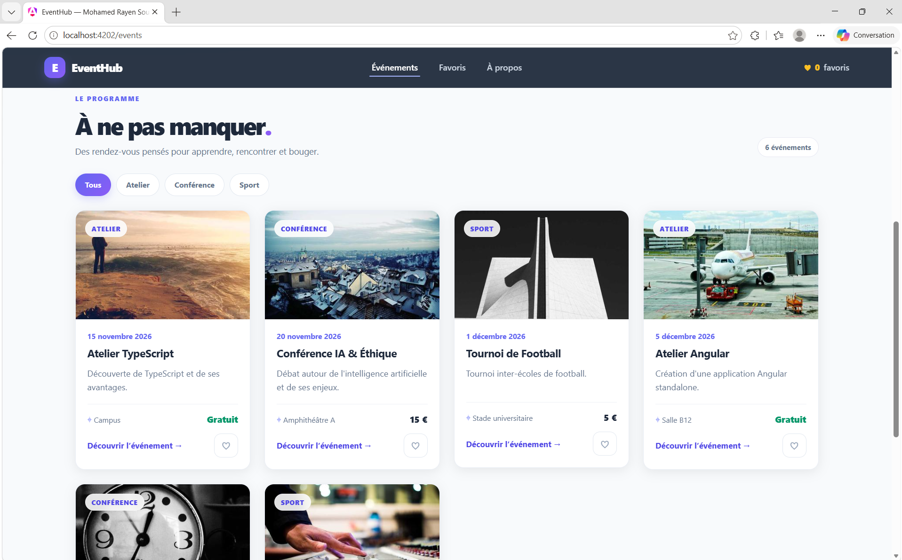
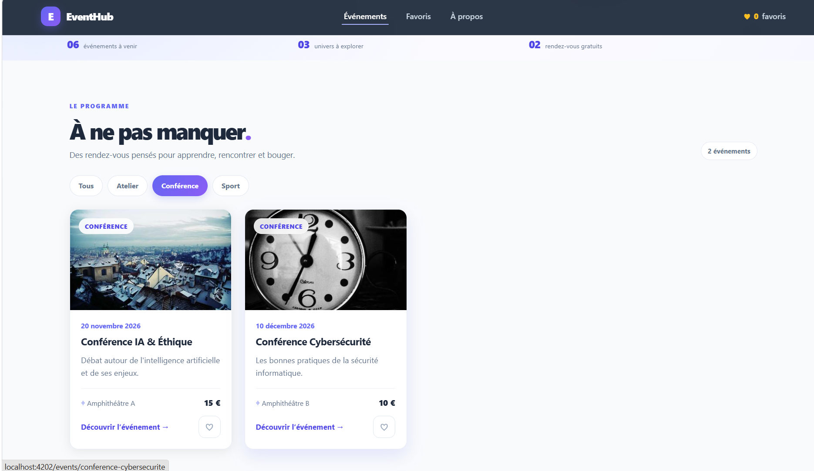
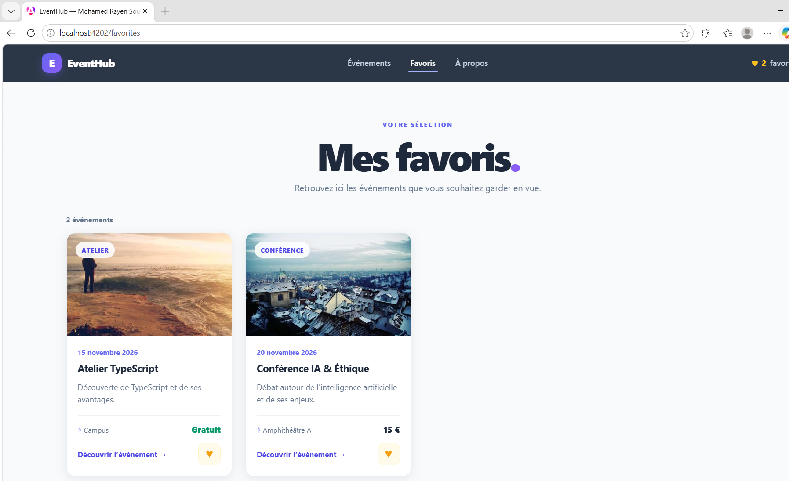
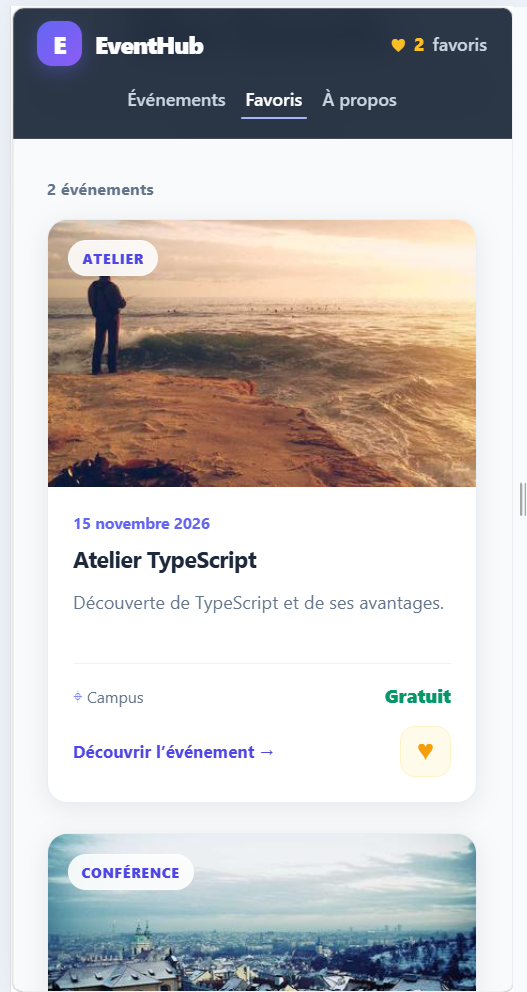

# EventHub, Mohamed Rayen Souayah

EventHub est un catalogue responsive d'événements universitaires développé avec Angular 21 standalone. L'application permet de consulter six événements, de filtrer par catégorie, de gérer une liste de favoris et d'afficher les détails de chaque événement.

## Fonctionnalités

- Catalogue de six événements répartis en trois catégories.
- Filtres par atelier, conférence et sport.
- Gestion des favoris et compteur dans le menu.
- Page Favoris dédiée.
- Pages de détail accessibles par identifiant.
- Page À propos chargée en lazy loading.
- Page 404 pour les URL inconnues.
- Interface responsive et navigation au clavier.

## Technologies

- Angular 21 standalone et TypeScript.
- Signals : `signal()`, `computed()`, `set()` et `update()`.
- Control flow : `@if`, `@else`, `@for` et `@empty`.
- Pipes : `date`, `currency` et `uppercase`.
- Communication entre composants avec `input()` et `output()`.
- Angular Router, `withComponentInputBinding()` et `loadComponent()`.
- CSS natif.

## Installation et lancement

Prérequis : une version de Node.js compatible avec Angular 21 et npm.

```bash
npm install
npm start
```

Ouvre ensuite l'adresse locale indiquée dans le terminal. Par exemple, `http://localhost:4200/` ou `http://localhost:4201/`, selon le port utilisé.

## Tests

```bash
npm test -- --watch=false
npm run build
```

## Captures d'écran

Les captures sont enregistrées dans `docs/screenshots/`.

### Catalogue des événements



### Filtre par catégorie



### Détail d'un événement favori



## Page À propos sur mobile
