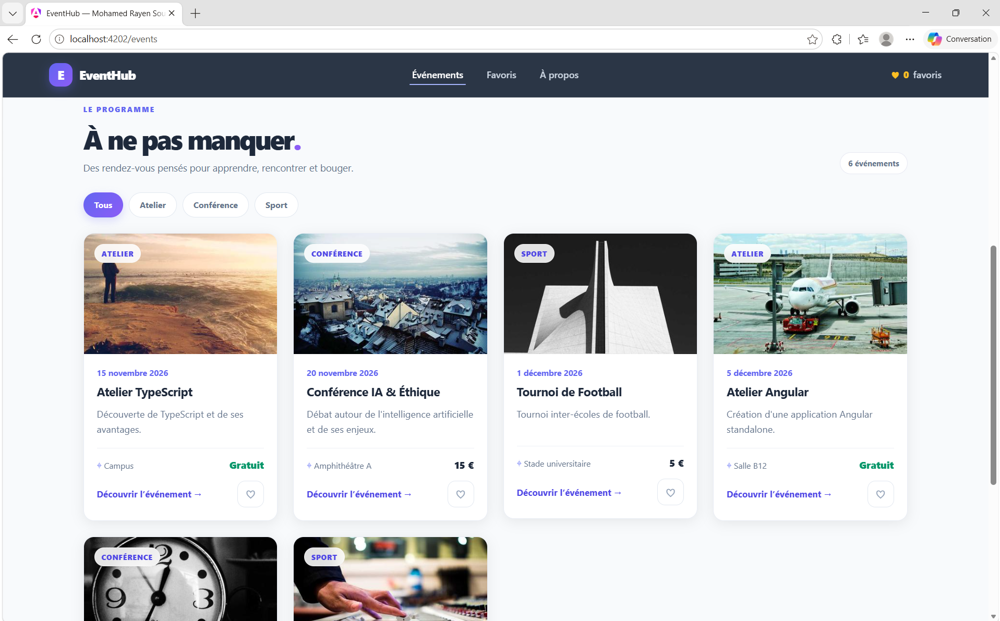
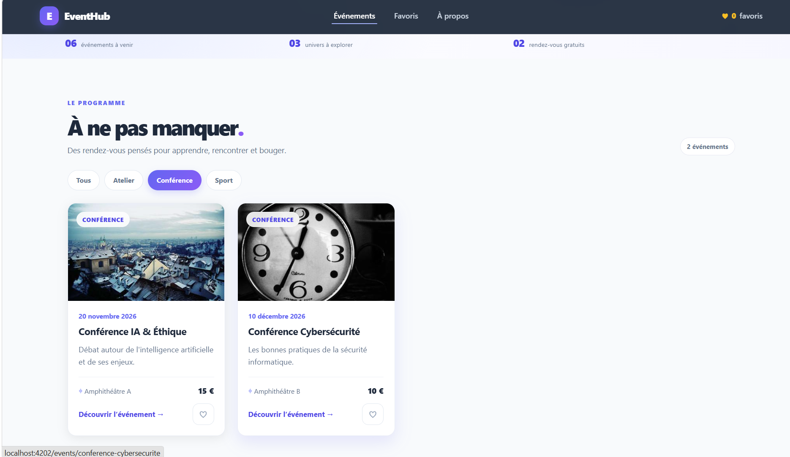
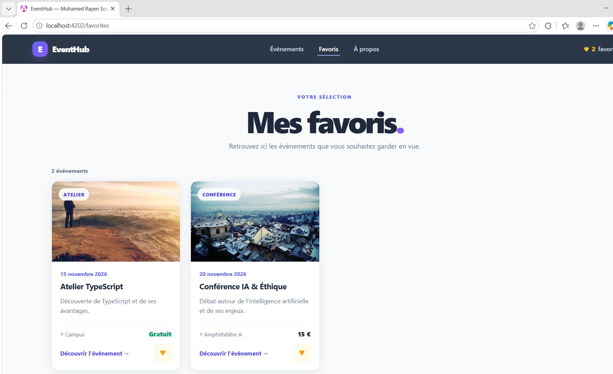
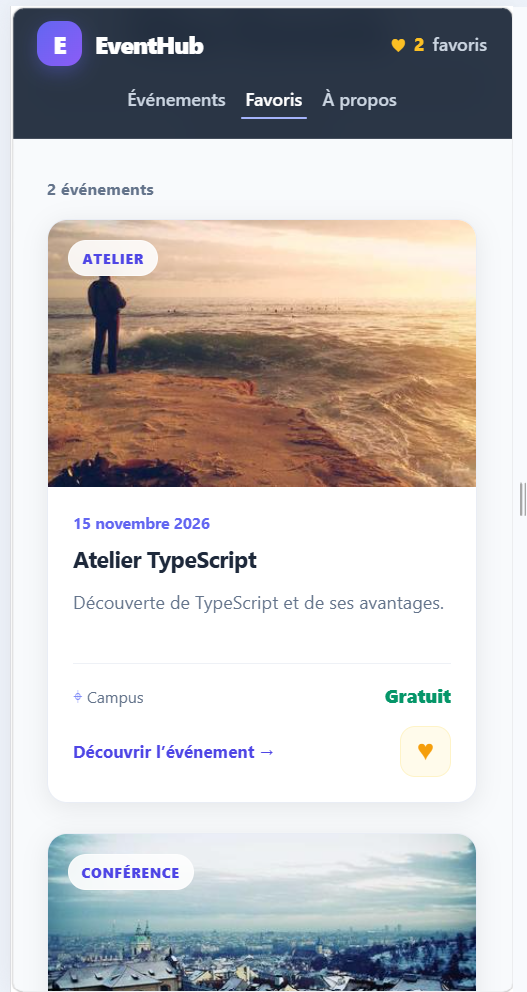
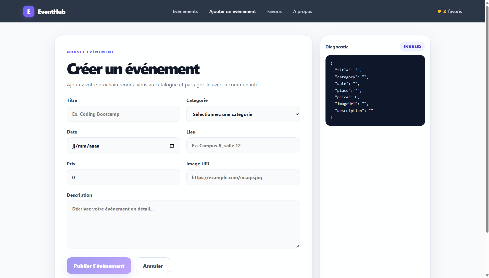
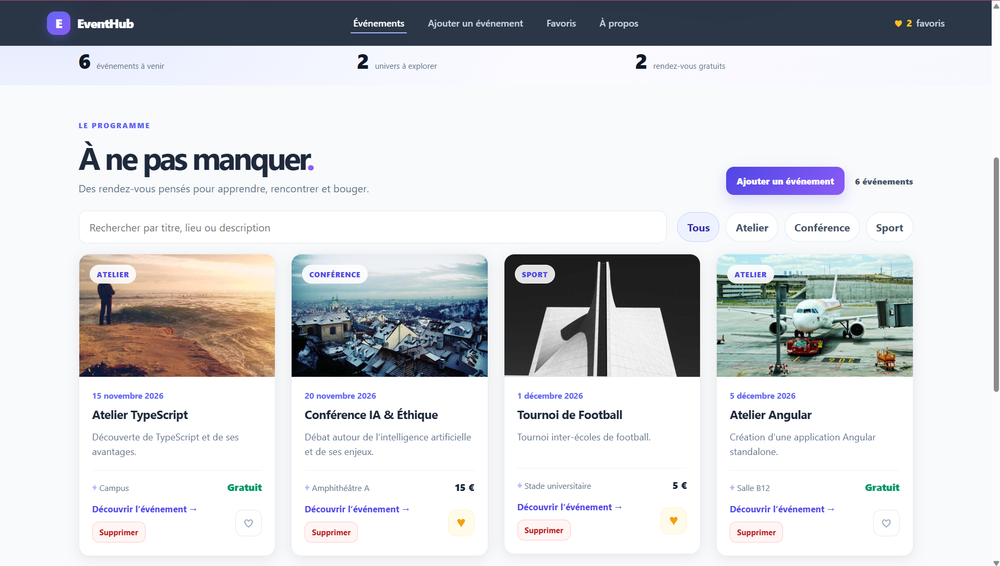

# EventHub

EventHub est une plateforme de gestion et de découverte d'événements universitaires, développée avec Angular 21 en architecture standalone. Le projet couvre la Partie 1 et la Partie 2 du cahier des charges, avec un catalogue dynamique, des favoris, un service centralisé avec Signals, ainsi qu'un formulaire de création d'événements entièrement validé.

## Technologies utilisées

- Angular 21
- TypeScript
- Angular Router
- Reactive Forms
- Signals Angular (`signal`, `computed`, `asReadonly`, `set`, `update`)
- Standalone components
- CSS moderne et responsive

## Fonctionnalités

### Partie 1

- Catalogue d'événements
- Filtres par catégorie
- Recherche par mot-clé
- Favoris avec compteur global
- Détail des événements
- Page favoris
- Page À propos
- Page 404
- Navigation responsive

### Partie 2

- Service `EventService` unique source de vérité
- Computed Signals : total, favoris, gratuits
- Création d'événement via formulaire réactif
- Validation avancée du formulaire
- Aperçu d'image
- Diagnostic du formulaire en direct
- Ajout réel dans le Signal partagé
- Suppression avec confirmation
- Toasts de notification
- Route `/events/add` et navigation dédiée

## Architecture du projet

- `src/app/components` : composants Angular
- `src/app/services` : services et logique partagée
- `src/app/models` : modèles TypeScript
- `src/app/data` : catalogues initiaux
- `src/app/pages` : pages spécifiques

## Installation

Prérequis : Node.js compatible avec Angular 21 et npm.

```bash
npm install
```

## Lancement

```bash
npm start
```

Puis ouvrez l'application dans le navigateur sur l'URL affichée par Angular (par défaut `http://localhost:4200`).

## Exemples d'utilisation

- Ouvrir le catalogue : `/events`
- Ajouter un événement : `/events/add`
- Consulter un détail : `/events/:id`
- Voir les favoris : `/favorites`

## Captures d'écran

Les captures d'écran du projet sont sauvegardées dans `docs/screenshots/`.

### Catalogue des événements



### Filtre par catégorie



### Détail d'un événement favori



### Version mobile



### Formulaire de création



### Liste des événements



### Autres captures


## Vérification

```bash
npm run build
```

Le build Angular doit se terminer sans erreur. Une alerte de budget CSS peut apparaître selon la configuration de l'environnement, mais la compilation reste valide.
